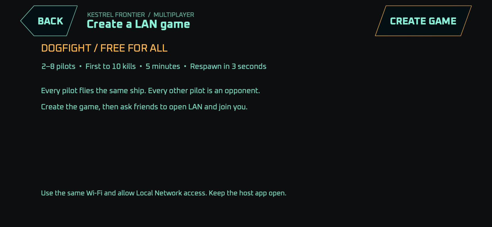
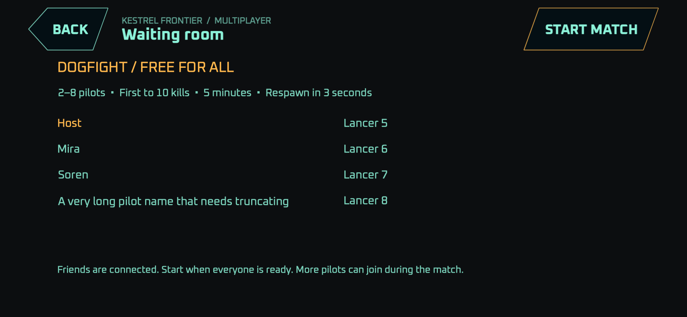
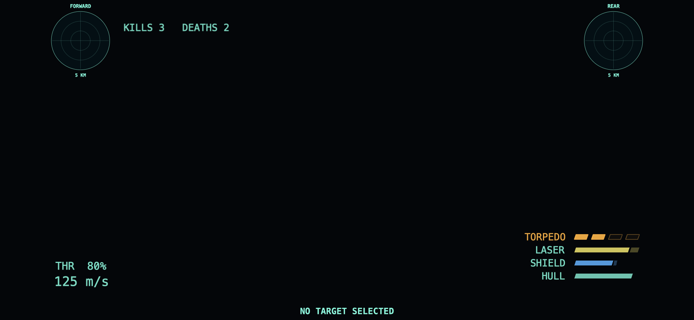
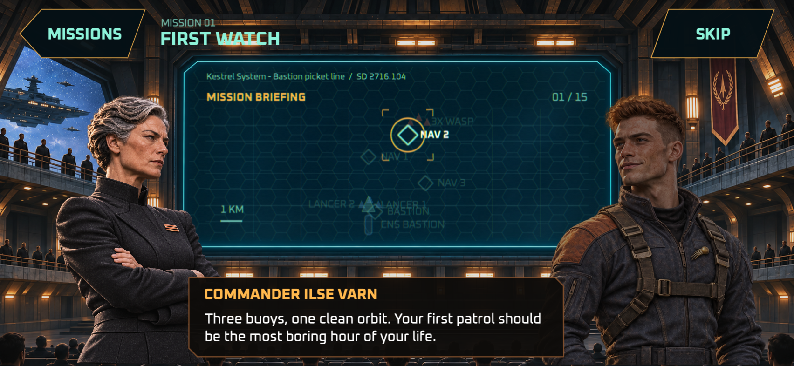

# Ревью релизного кандидата Kestrel Frontier

6 ноября 2026. Проверка начата с `dd4b39e`, исправления находятся в ветке
`release/lan-and-release-audit`.

## Решение о выпуске

Сборка пригодна для закрытого тестирования. Для публичного мобильного релиза
нужна короткая проверка на физических устройствах: полный LAN-матч между
iPhone и iPad и первые три миссии с сенсорным управлением. Автоматические
проверки и ручной запуск LAN на Mac прошли; сложность для нового мобильного
игрока и работа Wi-Fi между устройствами пока не подтверждены.

Главный функциональный пробел устранён: из меню теперь можно создать
соревновательную LAN-игру, дождаться друзей и начать бой. Подключённые игроки
появляются в комнате ожидания, а кнопка старта становится доступной при двух
пилотах. Повторный матч проходит через ту же комнату.

## Исправленные проблемы

| Проблема | Результат исправления |
| --- | --- |
| В LAN был только поиск серверов, без создания игры и правил PvP | Добавлены создание, комната ожидания, старт, результаты и повторный матч |
| Все игроки были союзниками и не возрождались | У каждого пилота своя сторона; выбор цели, урон и ракеты работают против других игроков; возрождение через 3 секунды |
| Поиск на iOS полагался на UDP broadcast | Добавлен Bonjour с объявленным типом `_kestrel._udp`; игровые пакеты и запросы адресные |
| Одиночная кампания автоматически открывалась сети | Сетевые подключения принимает только явно созданная LAN-сессия |
| Пауза хоста останавливала сетевой мир | В сетевом меню бой продолжается; одиночная пауза сохраняется |
| Сетевой результат мог записаться в личную кампанию | Матчи имеют отдельный экран результатов; удалённые миссии не меняют личные звёзды и открытые уровни |
| Подключение к отсутствующему хосту повторялось бесконечно | Действует таймаут и выводится причина отключения |
| Отключение во время регистрации ресурсов могло очищать их параллельно с загрузкой | Очистка и возврат в меню ждут завершения фоновой регистрации |
| HUD обещал возрождение после смерти в кампании | Сообщения кампании и dogfight разделены |
| Личный счёт был принудительно скрыт | Убийства и смерти видны в LAN; пустой блок целей скрывается |
| Соперникам приписывалась фракция из кампании | В PvP показывается тип их корабля |
| Кнопка H/F1 не открывала существующую справку | Справка снова переключается, переносит строки и помещается в безопасной области |
| Все мобильные игроки назывались Pilot | Создаётся сохраняемый позывной с коротким суффиксом; доступен cvar `name` |
| После ошибки bind сокет мог закрываться повторно | После закрытия файловый дескриптор сбрасывается |
| Выпущенная ракета сохраняла владельца после его отключения | Владелец очищается, чтобы последующий игрок в этом слоте не получил чужое убийство |
| Спасение Ondine противоречило последующей истории о пленниках | Итог миссии точно сообщает о пяти спасённых капсулах, а не обо всём экипаже |

Создание доступно мышью, касанием, клавиатурой и меню контроллера. Строки
серверов увеличены до 52 точек, список прокручивается, выбранный сервер
сохраняется при обновлении. Изменение safe area учитывается при раскладке.
Короткие экраны показывают восемь пилотов в двух колонках.

Bonjour завершается на главном потоке. При ошибке объявления или поиска
показывается сообщение, а закрытие хостом сессии отправляет гостям отключение.
Сетевой протокол обновлён до 6, API игрового модуля до 4: старые клиенты не
должны принимать dogfight за обычную миссию. Все участники должны обновиться.

## Интерфейс и анимации

На Mac вручную проверены главное меню, сетевой браузер, создание, комната
ожидания с отдельным клиентом, загрузка боя, HUD, пауза и возврат в LAN.
Обнаруженные проблемы счёта и подписи противника исправлены. Постоянного
перекрытия элементов на проверенных экранах не обнаружено.

Рендеры и проверки геометрии покрывают компактный телефон 667×375,
телефон 852×393 с боковыми отступами и нижней безопасной областью,
iPad 1194×834 и десктопные размеры. Дополнительно проверяется устойчивость
HUD к узкой портретной области; само iOS-приложение поддерживает landscape.
Проверены все брифинги и эпилоги, переносы текста при печати, прокрутка,
кнопки не ниже 44 точек в проверяемой навигации и выходы из экранов.

Развёртка текста и короткий CRT decode остаются частью художественного
оформления. Системный Reduce Motion учитывается; cvar `ui_motion fade`
доступен для более спокойных переходов. Это не гарантия отсутствия любого
светового эффекта в игре: оружие и lens flare анимируются намеренно.

Проверки размеров выполняются SpriteKit на Mac. Их PNG не заменяют полный
прогон UIKit, вращения устройства и одновременных касаний на iPhone/iPad.
Нативная iOS-сборка успешно собрана. Полноценный ручной мобильный прогон
в этой проверке не завершён: iPhone-симулятор оказался занят другой игрой,
а первый запуск iPad-симулятора перегрузил Mac и был остановлен.

## Кампания и доступность

Сюжетная цепочка понятна: утечка расписания приводит к манифестам Tarn,
выжившие с Ondine дают новые сведения, расследование выводит на Hale,
а спасённые люди помогают остановить Hammer. Реплики перед боем объясняют
цели сканирования, сопровождения, захвата и атаки подсистем. Исправлено
противоречие между спасением пяти капсул и поздним обнаружением пленников.

Все 20 миссий Kestrel Frontier и обе миссии Ember Reach достигают победы
в проверке сценариев; каждая также корректно заканчивается поражением после
гибели игрока. Прогон использует настоящие уровни, геометрию подсистем,
события, прибытия, маршруты сопровождения и ИИ абордажных кораблей. Проверена
цепочка захвата Gorran и последовательность целей финального боя.

В этом прогоне тестовый пилот перемещается прямо к нужным точкам, уничтожает
нужные цели и выключает требуемые подсистемы. Обычный бой исключён.
Это подтверждает связность сценариев и отсутствие найденных тупиков в целях;
человеческое прохождение всей кампании и её сложность такой тест не доказывает.
Вручную вся кампания не пройдена.

Первая миссия выглядит разумным введением: три неопытных противника,
напарник и простой маршрут. Главная точка проверки баланса — третья миссия:
за 150 секунд приходят десять бомбардировщиков и пять истребителей,
при этом у игрока нет напарника. Для телефона это возможный ранний скачок
сложности. Нужно проверить, успевает ли новый игрок защищать ретранслятор,
а не только выживать самому.

Для первой версии рекомендован один доступный базовый баланс. Маски появления
монстров и предметов по сложности сейчас не нужны. Публичный LAN-режим —
PvP; базовый кооп кампании остаётся через dedicated server и не получил
дополнительных режимов. Если кооп будет отдельной функцией, предложенная
плавная шкала эффективного здоровья врагов подходит для первоначальной
проверки: `1 + 0.5 × log2(N)`, то есть 1.5 для двух игроков и 2 для четырёх.
В этом PR изменение баланса коопа не включено.

## Сетевой матч

Последовательность: **LAN DOGFIGHT → CREATE GAME → друзья выбирают хост →
START MATCH**. Матч рассчитан на 2–8 пилотов. Все летают на одном типе корабля;
каждый другой пилот — противник. Победа по 10 убийствам или окончание по
таймеру 5 минут. Корабль возрождается через 3 секунды, счёт сохраняется.
Допускается вход во время боя. Пока хост один, время матча не расходуется.

Отдельный процесс клиента успешно подключился по настоящему UDP к обычному
Mac-приложению, появился в комнате ожидания и получил игровые кадры после
старта. Это проверка разных процессов на одном Mac. Bonjour также проверен
с настоящим объявлением сервиса на случайном порту за пределами старого
диапазона сканирования. Матч между физическими устройствами остаётся
непроверенным. Хост должен держать приложение открытым на экране.

В оригинальном руководстве LineWars II, стр. 34, Group War описан как бой
каждого против каждого с входом игроков по ходу игры; Star Wars — совместный
бой против компьютера. Этот принцип использован для выбора простого PvP,
без копирования старого интерфейса или протокола. Руководство доступно
[в архиве автора](https://linewars.patrickaalto.com/lw2r.zip).
Требование iOS для UDP broadcast и отличие Bonjour описаны в
[документации Apple](https://developer.apple.com/documentation/technotes/tn3179-understanding-local-network-privacy).

## Результаты проверок

| Проверка | Результат |
| --- | --- |
| macOS `./build.sh` | PASS |
| iOS `./build.sh ios-simulator` | PASS |
| Unit checks и каталог строк | PASS, 255 ключей в 21 локали с fallback на английский |
| Network checks | PASS, потери пакетов, несовместимые версии, UDP, Bonjour, PvP и таймаут |
| Campaign flow | PASS, 22 победы и 22 поражения после гибели игрока |
| Story validator | PASS, 20 основных миссий, 128 сюжетных реплик и отдельная LAN-арена |
| GUI portraits и safe areas | PASS |
| Dialogue typing и переходы | PASS |
| Flight UI, LAN и справка | PASS |
| Mouse input | PASS |
| Audio | PASS |
| Lens flare | PASS |

Логи текущей проверки лежат в `build/release-*.log`; подробные сетевые
результаты и логи кампаний сохраняются в `build/network-checks.*/`.
CI публикует логи кампаний вместе с сетевыми результатами.

## Проверка перед публичным выпуском

1. На физических iPhone и iPad создать матч с каждого устройства по очереди,
   проверить разрешение Local Network, подключение, полный матч, возрождение,
   результаты и повторный старт. Проверить потерю сети, в том числе во время
   загрузки, и выход хоста.
2. На телефоне проверить обе landscape-ориентации, домашний индикатор,
   одновременное управление и стрельбу, паузу, возврат и отсутствие удержанных
   кнопок после переключения приложения.
3. Дать новому игроку пройти первые три миссии без подсказок разработчика.
   При проблемах сначала смягчить ранние волны и добавить адресные подсказки;
   меню сложности для этого не требуется.

## Превью телефонных раскладок

Эти изображения получены из проверок SpriteKit при 852×393 точках с
телефонными безопасными отступами.

